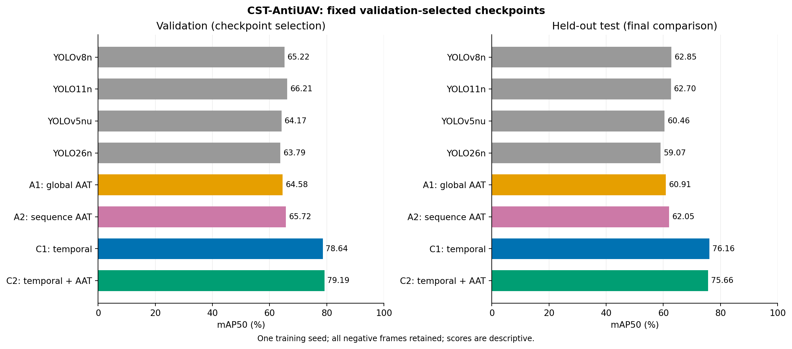
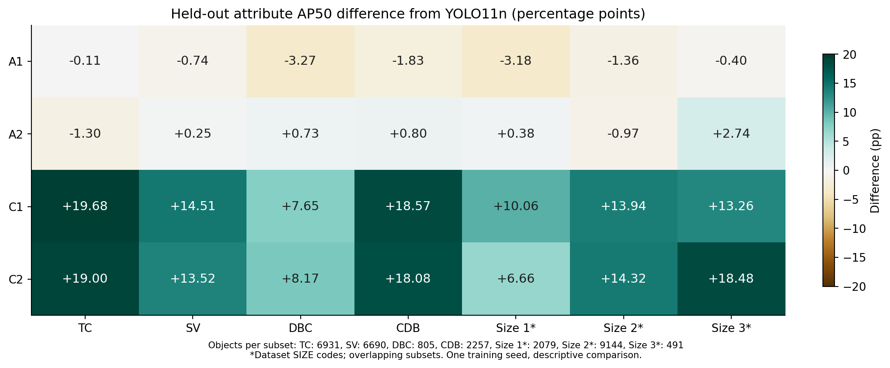
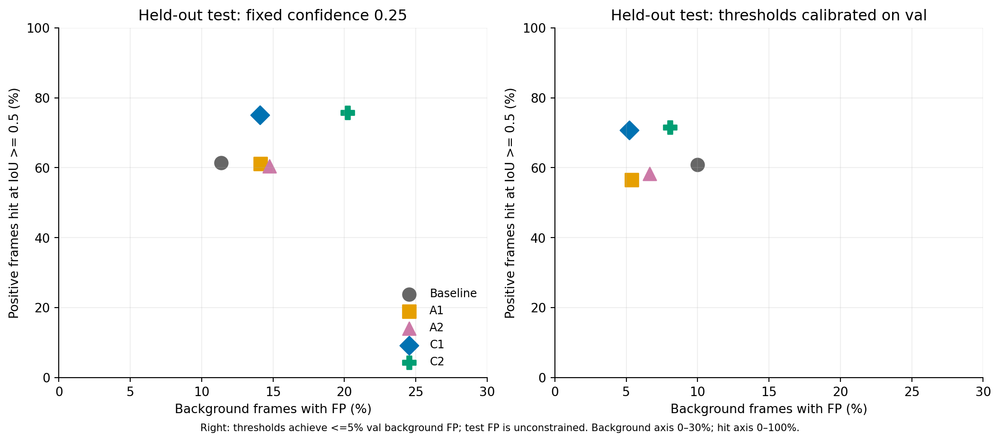
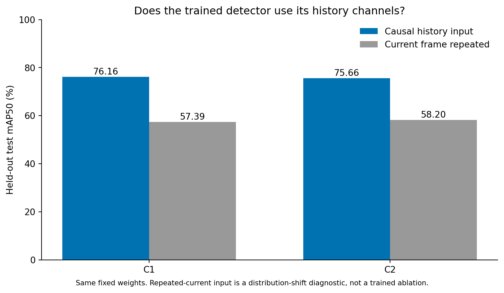
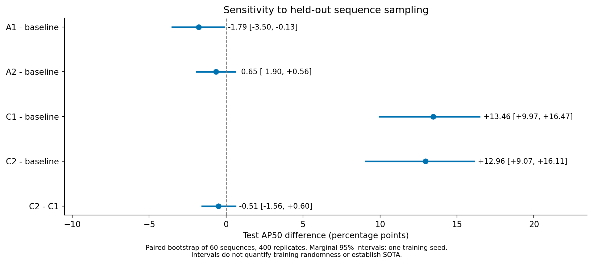
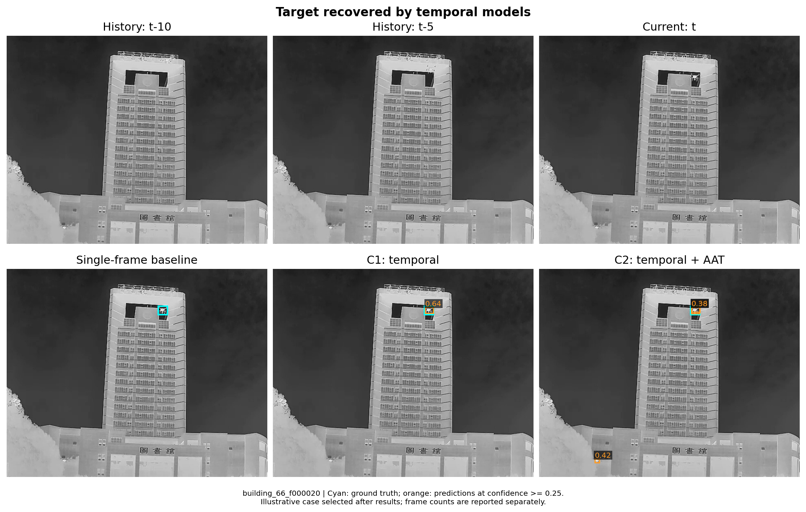
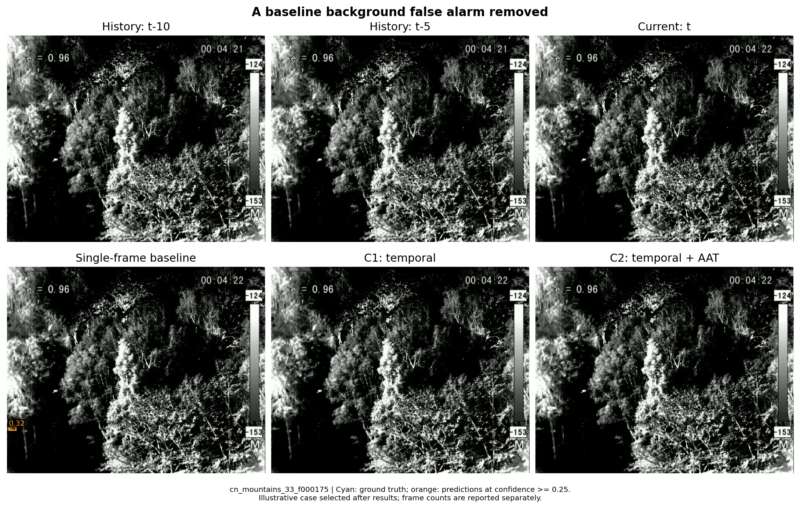
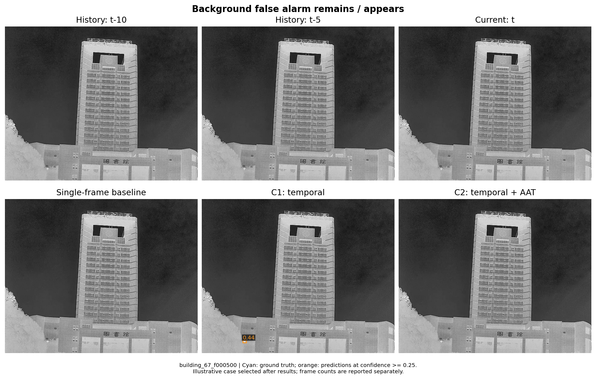
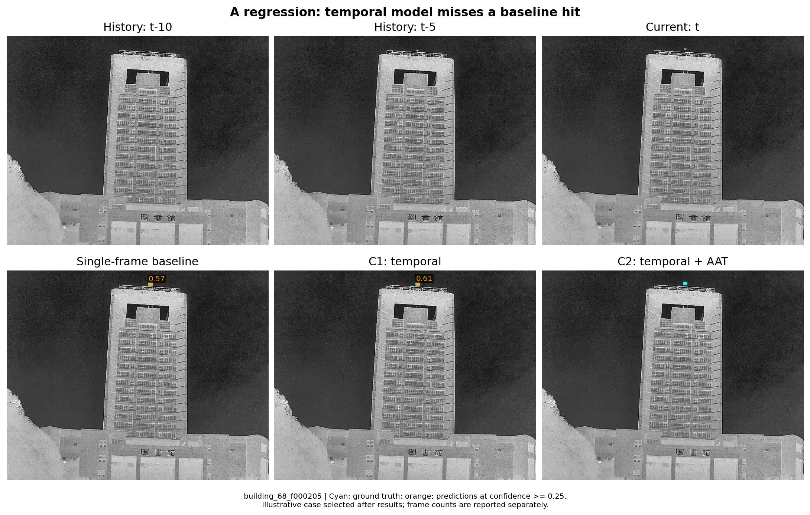

# CST 基线、A1/A2、C1/C2：完成后统一测试与评价

日期：2026-10-17。下列数值来自实际模型权重和逐帧预测。百分数与“百分点差”分开报告；验证集用于选权重，独立 test 用于最终评价。

## 先看结论

这一轮的有效增量来自时序输入：C1 的 test mAP50 为 76.16%，相对 YOLO11n 基线为 +13.46 个百分点；C2 为 75.66%，相对基线为 +12.96 个百分点。

A1/A2 单独使用 AAT 没有带来点估计收益：相对基线分别为 -1.79、-0.65 个百分点。这两项结果应作为负面消融保留，不能继续把“AAT 提升整体精度”写成已经验证的贡献。

以验证集的精度和误报权衡，建议 C1 作为后续主线，C2 保留作消融：C2 的 val AP50 只比 C1 高约0.56个百分点，val 背景误报却多约3.37个百分点。这个建议依据 val 作出，不按 test 挑模型。

还有一个比固定0.25阈值更有工程意义的结果：各模型都仅用 val 选择阈值，使 val 背景误报约为5%，然后原样用于 test。基线的 test 误报为9.99%、正帧命中为60.88%；C1 分别为5.21%和70.73%。这组观察支持 C1 配合验证集校准具有实用价值；它不抹去预设固定0.25误报门未通过的事实。

## 统一测试口径

所有模型均使用原生 best.pt，即训练时按 val mAP50–95 选出的权重。没有用 test 选轮次，也没有把 CSV 中 AP50 最大值直接抄进测试表。训练上限100轮、patience=20，提前停止属于既定配置。

| 划分 | 帧数 | 目标数 | 背景帧数 | 序列数 |
| --- | --- | --- | --- | --- |
| train | 25612 | 22000 | 3612 | 120 |
| val | 9066 | 7819 | 1247 | 40 |
| test | 14446 | 11854 | 2592 | 60 |

统一推理配置：imgsz=640、矩形补边、batch=128、FP16、conf=0.001、NMS IoU=0.7、max_det=300、workers=2。AP 计算保留全部背景帧。AP50–95 是 IoU 0.50:0.05:0.95，不是 AP50–90。原来的 val 审计用 workers=4，加载线程数不改变该 AP 协议。

实际 test 张量形状已逐批记录并核对：八个模型均为3×544×672。imgsz=640 是配置值，矩形补边后的张量不是640×640。下文复杂度表另按640×640统一估算 GFLOPs，不把它当成本次544×672验证的精确运算量。

模型最佳 F1 处的 P/R 是评测摘要，不能当作统一部署阈值。下表误报率和命中率统一使用固定置信度0.25：误报率=有至少一个预测框的背景帧数÷背景帧数；命中率=至少有一个 IoU≥0.5 正确框的有目标帧数÷有目标帧数。

## 八个模型的完整对比

| 模型 | 停止轮次 | val AP50% | test AP50% | test AP50–95% | test ΔAP50/pp | test 背景误报% | test 正帧命中% |
| --- | --- | --- | --- | --- | --- | --- | --- |
| YOLOv8n | 31 | 65.22 | 62.85 | 32.68 | +0.15 | 15.74 | 63.14 |
| YOLO11n 基线 | 65 | 66.21 | 62.70 | 34.49 | +0.00 | 11.38 | 61.46 |
| YOLOv5nu | 95 | 64.17 | 60.46 | 33.84 | -2.24 | 17.79 | 60.78 |
| YOLO26n | 59 | 63.79 | 59.07 | 32.90 | -3.63 | 9.26 | 55.89 |
| A1：全局 AAT | 68 | 64.58 | 60.91 | 33.59 | -1.79 | 14.12 | 61.17 |
| A2：序列配额 AAT | 58 | 65.72 | 62.05 | 33.88 | -0.65 | 14.74 | 60.42 |
| C1：因果时序输入 | 87 | 78.64 | 76.16 | 40.36 | +13.46 | 14.08 | 75.09 |
| C2：时序＋序列 AAT | 58 | 79.19 | 75.66 | 38.84 | +12.96 | 20.22 | 75.70 |

## 哪些困难属性得到了改善

| 属性 | 帧/目标/背景 | 基线 AP50% | A1 | A2 | C1 | C2 |
| --- | --- | --- | --- | --- | --- | --- |
| TC 热交叉 | 8443/6931/1512 | 45.90 | 45.79 | 44.59 | 65.58 | 64.89 |
| SV 尺度变化 | 6690/6690/0 | 56.71 | 55.96 | 56.95 | 71.22 | 70.22 |
| DBC 动态背景杂波 | 1728/805/923 | 56.57 | 53.31 | 57.31 | 64.23 | 64.74 |
| CDB 复杂动态背景 | 2876/2257/619 | 48.79 | 46.96 | 49.58 | 67.36 | 66.86 |
| SIZE 原始编码1 | 2079/2079/0 | 41.37 | 38.19 | 41.75 | 51.42 | 48.03 |
| SIZE 原始编码2 | 9144/9144/0 | 68.27 | 66.92 | 67.31 | 82.22 | 82.60 |
| SIZE 原始编码3 | 491/491/0 | 75.42 | 75.02 | 78.16 | 88.68 | 93.90 |
| SIZE 原始编码4 | 65/65/0 | 20.81 | 12.29 | 22.71 | 40.66 | 30.85 |
| OC 遮挡 | 1301/5/1296 | 0.86 | 0.01 | 0.00 | 29.75 | 0.59 |
| OV 出视野 | 1261/5/1256 | 0.00 | 0.00 | 0.00 | 0.06 | 0.01 |
| FM 快速运动 | 23/23/0 | 39.82 | 44.62 | 45.80 | 57.04 | 63.52 |

SV 的含义是尺度变化，不能直接翻译成“小目标”；DBC/CDB 是背景杂波相关属性，不能翻译成明暗差。各属性可以重叠，不能把各组结果当独立样本。SIZE 沿用原始编码，不擅自换成 COCO APsmall。OC/OV 的有效正目标数和 FM 样本量见上表；稀少正目标组的 AP 不用于下强结论。

## 精度与误报必须一起看

基线 test 背景误报率为 11.38%，C1 为 14.08%，C2 为 20.22%。因此是否能说“抑制误报”，必须区分固定阈值、校准阈值和具体数据划分，不能仅根据 AP 增长推断。

训练前合同已声明：val 背景误报率最多允许比基线增加2个百分点，标准 recall 最多下降1个百分点。C1/C2 的 val 误报增幅均超过该门槛，因此本轮只能报告精度与误报的权衡，不能写成无代价的全面改善。

| 模型 | val选定阈值 | val 背景误报% | test 背景误报% | test 正帧命中% |
| --- | --- | --- | --- | --- |
| YOLO11n 基线 | 0.29028 | 4.97 | 9.99 | 60.88 |
| A1：全局 AAT | 0.54541 | 4.97 | 5.36 | 56.52 |
| A2：序列配额 AAT | 0.43115 | 4.89 | 6.64 | 58.26 |
| C1：因果时序输入 | 0.52051 | 4.97 | 5.21 | 70.73 |
| C2：时序＋序列 AAT | 0.48047 | 4.97 | 8.06 | 71.52 |

上表阈值仅从 val 中选择，使 val 背景误报≤5%，再原样应用于 test。test 误报并未被强制为5%，没有在 test 上重新调阈值。这能减小模型置信度标定差异的影响，但仍不是相同 test 误报率下的严格比较。

## 白盒诊断：模型是否使用了历史信息

C1/C2 不改网络层数，而把原来同一红外图复制出的三通道改为“当前、过去5帧、过去10帧”。只有过去和当前图像，标签仍只属于当前帧，不读取未来帧和历史真值框。test 的历史输入按原规则新生成，与 train/val 的序列严格分离。

| 固定权重 | 正常历史输入 AP50% | 历史改成当前帧复制 AP50% | 复制减正常/pp |
| --- | --- | --- | --- |
| C1：因果时序输入 | 76.16 | 57.39 | -18.78 |
| C2：时序＋序列 AAT | 75.66 | 58.20 | -17.46 |

如果复制当前帧后变差，说明这些已训练模型依赖历史通道的信息；但这也是一次输入分布改变，不能单凭它证明“运动是唯一原因”，也不能替代从头训练的重复当前帧对照。

## 差值对测试序列的敏感性

| 比较 | 观察差值/pp | 序列 bootstrap 95%区间/pp |
| --- | --- | --- |
| A1_aat_global − yolo11n | -1.79 | [-3.50, -0.13] |
| A2_aat_sequence − yolo11n | -0.65 | [-1.90, +0.56] |
| C1_temporal_uniform − yolo11n | +13.46 | [+9.97, +16.47] |
| C2_temporal_aat_sequence − yolo11n | +12.96 | [+9.07, +16.11] |
| C2_temporal_aat_sequence − C1_temporal_uniform | -0.51 | [-1.56, +0.60] |

以完整序列为单位做配对 bootstrap（60序列、400次），没有把相邻视频帧当独立重复。区间仅反映这组固定权重在 test 序列抽样下的变化；没有覆盖训练随机种子，也不是多比较同时置信区间。本轮未做确认性显著性宣称。

## 复杂度与当前证据边界

| 模型 | 未融合参数量/M | 640正方形 GFLOPs |
| --- | --- | --- |
| YOLOv8n | 3.138003 | 8.749 |
| YOLO11n 基线 | 2.604883 | 6.567 |
| YOLOv5nu | 2.635619 | 7.733 |
| YOLO26n | 2.533886 | 6.027 |
| A1：全局 AAT | 2.604883 | 6.567 |
| A2：序列配额 AAT | 2.604883 | 6.567 |
| C1：因果时序输入 | 2.604883 | 6.567 |
| C2：时序＋序列 AAT | 2.604883 | 6.567 |

YOLO11n、A1、A2、C1、C2 的未融合参数量均为2,604,883，网络计算图的 GFLOPs 一致。因此可称“网络参数不增加”。时序缓存、输入构造和文件解码仍有成本，不能据此称端到端零延迟。当前为共享 RTX PRO 6000 上的评测，批量耗时不能冒充边缘设备部署延迟。

C1 中途曾收到 SIGKILL，保全第42轮检查点后，从第43轮恢复优化器和 EMA，训练 worker 改为2、验证 worker 改为4，最终第87轮正常早停。其 best.pt 对应第67轮；本轮评测使用的就是这个 best.pt。中断前后随机过程不保证逐位相同。

另一个代码细节：C1 恢复脚本没有继续更新额外的 bestAP50.pt，因此该文件不能代表恢复后的最大 AP50。本报告完全没有使用它，原生 best.pt 正常更新。

基线采用框架的随机加载，A/C 路线采用自定义 EpochSampler；时序路线另用共享亮度增强保持通道语义。当前对比支持“时序输入训练方案整体有效”的工程结论，不能把全部差值唯一归因于某个机制。后续最小补强应是相同加载与亮度设置的重复当前帧训练对照，再补独立种子。

## 对后续研究的评价

AAT：这轮不适合作为主创新。时序输入：已经有清楚的机制、真实的独立 test 对比和零新增网络参数证据，适合作为后续论文主线。它属于输入设计与训练应用的改进，不能表述成提出了全新的网络结构。是否达到领域 SOTA 或具备充分的新颖性，仍须与同类时序反无人机方法在相同任务和划分下对比。检测 mAP 不能直接与跟踪 mSA 比较。

建议下一步围绕 C1 做小而完整的验证：统一增强/加载的重复帧训练对照、独立种子复验、明确的背景误报控制、batch1端到端计时。C2 的 AAT 贡献先作为待验证的增量，不把两个模块简单叠加就写成已验证协同。

## 能否投 MVIIPR：定位与最少补强

判断：有值得准备投稿的真实结果，适合走应用与实证研究路线；当前不宜包装成原创时序网络。与用户给出的会议主题匹配，不代表一定录用。最合适的研究问题是：在参数不增加的轻量红外检测器中，因果时序输入是否比困难属性重采样更有效，其精度和误报收益能否迁移到独立视频序列？

文献核查纠正两条旧判断：三帧灰度通道堆叠至少已有 WACVW 2023 的 Exploiting Temporal Context for Tiny Object Detection 和 Sensors 2024 的 Temporal-YOLOv8；而2026-10-06发布的预印本已在 CST 上研究小无人机检测并比较框检测器。因此不能再声称首次提出三帧输入，或首次在 CST 研究检测。只使用过去帧是本实现的在线约束，不作为已经证明的独创方法。

投稿前优先补三件事：①相同 EpochSampler、共享亮度增强、batch和种子设置下，训练“当前帧复制三次”的严格对照，排除训练流程差异；②加入接近已有 Temporal-YOLO 的时序设置或帧差输入对照，并做一组时间间隔消融，明确本应用中的选择依据；③batch1计时，包含缓存与输入构造，报告硬件和测量范围。再做独立种子复验会明显增强说服力。若要主张边缘部署实效，仍需要对应设备的真实测量。

建议标题：因果时序输入在轻量红外反无人机检测中的有效性与误报分析。建议贡献：可复核的轻量检测对比协议；因果输入在该协议下的真实独立test收益；属性、重采样负结果与验证阈值迁移的系统分析。将其写成适配与评测贡献，不列“首次”或“全新网络”。

- [Corsel et al., WACVW 2023, Exploiting Temporal Context for Tiny Object Detection](https://openaccess.thecvf.com/content/WACV2023W/RWS/html/Corsel_Exploiting_Temporal_Context_for_Tiny_Object_Detection_WACVW_2023_paper.html)

- [van Leeuwen et al., Sensors 2024, Toward Versatile Small Object Detection with Temporal-YOLOv8](https://publications.tno.nl/publication/34643397/aHTTXwcv/leeuwen-2024-towards.pdf)

- [Xie et al., ICCVW 2025, CST Anti-UAV](https://arxiv.org/abs/2507.23473)

- [Son et al., 2026-10-06预印本, What Frame-Level Labels Can and Cannot Do for Small-UAV Point Detection in Thermal Video](https://arxiv.org/abs/2610.07705)

## 真实案例：改善与失败一起展示

## 复核文件

comparison.json / comparison.csv：全部主表与属性结果；model_inventory.json：权重哈希、配置与复杂度；evaluations/：逐模型审计、逐帧统计和真实预测框；test_data_audit.json：时序 test 输入检查；evaluation_plan.json：评测前固定模型清单；源码脚本保留于同目录。

证据文件的本地哈希、帧数、实际输入形状及11项评测退出状态已核对，见 delivery_integrity.json。所安装技能的 result_card_gate 因缺少共享运行库未能运行，详见 skill_gate_status.json；不将其记作通过，也不将这次描述性结果自动放行成确认性投稿结论。
