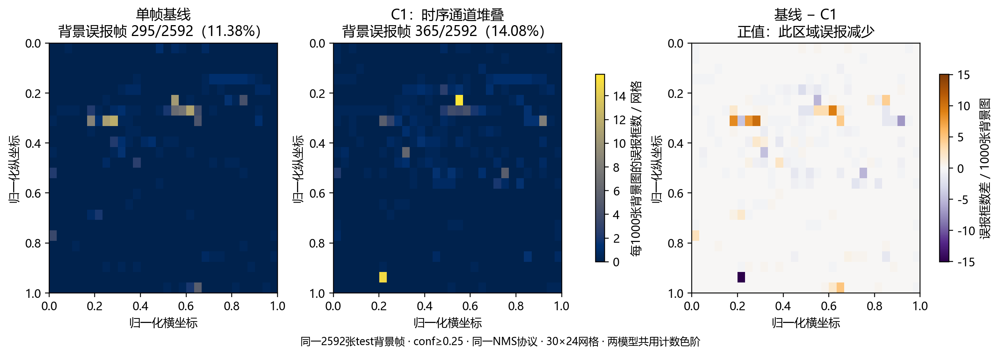
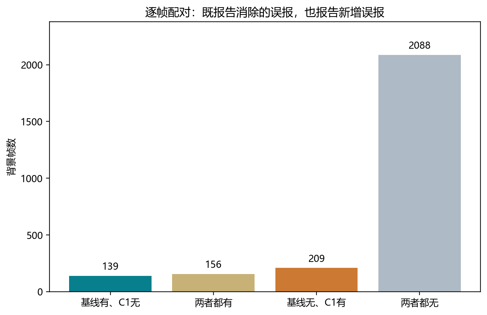

# C1背景误报位置与配对分析

来自已经完成的同一批2592张test背景帧，固定conf≥0.25，复用冻结预测，不重新调阈值。

| 模型 | 有误报背景帧 | 误报帧率 | 误报框总数 |
|---|---:|---:|---:|
| YOLO11n单帧 | 295 | 11.38% | 389 |
| C1时序输入 | 365 | 14.08% | 447 |

逐帧比较：139张从有误报变成无误报；209张出现新增误报；156张两者都有误报。

**固定0.25阈值下，C1背景误报帧率增加了2.70个百分点，净新增70张误报帧。不能将主张写为“统一阈值下全面抑制背景”。已有召回/AP收益及按val校准阈值后的工作点需要分开报告。**

能支持的结论：在相同阈值与相同背景帧上，C1改变了误报的发生率和空间分布；同时报告新增失败，避免只展示成功。

不能仅凭本图证明：模型识别的是运动、特定云边或建筑纹理。跨场景的归一化图像坐标不是同一物理位置，位置热图不是注意力图。这里不再使用已被证伪的“旧目标残影”解释。完整的运动依赖判断应结合已有repeat-current输入干预和同帧预测对比。

本分析使用已经看过的test结果，为描述性补充；不能写成新方法选择后的独立盲测。
